# 03 · Modelo de datos propuesto

Este modelo reemplaza las columnas con claves separadas por comas del Excel por tablas de detalle, así los conteos de uso y de stock salen de registros y no de buscar texto. Es una propuesta conceptual para Firebird; los tipos y los índices se definen al construir.

## Diagrama entidad-relación

```mermaid
erDiagram
    USUARIO }o--|| ROL : tiene
    USUARIO |o--o| DOCTOR : "es (rol Doctor)"

    HOSPITAL ||--o{ CONTACTO_HOSPITAL : tiene
    DOCTOR ||--o{ CIRUGIA : encarga
    HOSPITAL ||--o{ CIRUGIA : recibe
    PROCEDIMIENTO ||--o{ CIRUGIA : tipo
    PROCEDIMIENTO ||--o{ PLANTILLA_DETALLE : "plantilla base"
    KIT ||--o{ PLANTILLA_DETALLE : contiene

    EQUIPO ||--o{ PLANTILLA_DETALLE : "puede ir en"
    INSUMO ||--o{ PLANTILLA_DETALLE : "puede ir en"

    CIRUGIA ||--o{ CIRUGIA_EQUIPO : lleva
    CIRUGIA ||--o{ CIRUGIA_INSUMO : lleva
    CIRUGIA ||--o{ CIRUGIA_PERSONAL : asigna
    CIRUGIA ||--o{ COTIZACION_CONCEPTO : cotiza
    CIRUGIA ||--o{ GASTO : genera
    CIRUGIA ||--o{ CIRUGIA_HISTORIAL : registra
    CIRUGIA ||--o{ CHECKLIST_ITEM : verifica

    EQUIPO ||--o{ EQUIPO_UNIDAD : "tiene unidades"
    EQUIPO_UNIDAD ||--o{ CIRUGIA_EQUIPO : "se usa en"
    PROVEEDOR |o--o{ EQUIPO : surte
    PROVEEDOR |o--o{ INSUMO : surte
    INSUMO ||--o{ CIRUGIA_INSUMO : "se usa en"
    TECNICO ||--o{ CIRUGIA_PERSONAL : participa

    EQUIPO_UNIDAD ||--o{ MANTENIMIENTO : recibe
    EQUIPO ||--o{ TARIFA_EQUIPO : "se cotiza con"
    INSUMO ||--o{ MOVIMIENTO_INSUMO : mueve
    CIRUGIA ||--o{ MOVIMIENTO_INSUMO : origina

    ROL {
              int id PK
          string nombre "SYSADMIN, ADMIN, DOCTOR"
    }
    USUARIO {
              int id PK
              string usuario
              string hash_password
              int rol_id FK
              int doctor_id FK "nulo si no es doctor"
              bool activo
    }
    HOSPITAL {
              int id PK
               string clave "GTO-001"
               string nombre
               string direccion
               string estado
               string municipio
               string cp
               string telefono
               decimal latitud
               decimal longitud
               string liga_mapa
               blob foto
    }
    CONTACTO_HOSPITAL {
              int id PK
                        int hospital_id FK
                        string nombre
                        string puesto
                        string telefono
    }
    DOCTOR {
              int id PK
             string numero
             string nombre
             string tel_personal
             string tel_consultorio
             string ciudad
             string correo
    }
    TECNICO {
              int id PK
              string nombre
              string puesto "ayudante, enfermeria, anestesia"
              string telefono
    }
    PROCEDIMIENTO {
              int id PK
                    string nombre "Holep, Artroscopia..."
    }
    KIT {
              int id PK
          string clave "KIT-001"
          string nombre
    }
    PLANTILLA_DETALLE {
              int id PK
                        int procedimiento_id FK "o kit_id"
                        int kit_id FK
                        int equipo_id FK "o insumo_id"
                        int insumo_id FK
                        int cantidad
    }
    EQUIPO {
              int id PK
             string clave "EQ-001 (modelo)"
             string nombre
             string modelo_marca
             int proveedor_id FK "opcional"
             int ciclo_max "50"
             bool requiere_purga
             int purga_cada "5"
    }
    EQUIPO_UNIDAD {
              int id PK
             int equipo_id FK "modelo"
             string clave "EQ-001-01"
             string num_serie
             string codigo_qr
             date fecha_alta
             int usos_previos
             string estado "DISPONIBLE, RESERVADO, TRANSITO, EN_HOSPITAL, MANTENIMIENTO, FUERA"
             int hospital_actual_id FK
    }
    PROVEEDOR {
              int id PK
             string nombre
             string surte "EQUIPO, INSUMO o AMBOS"
             string contacto
             string telefono
             string correo
    }
    TARIFA_EQUIPO {
              int id PK
                    int equipo_id FK
                    decimal costo_hora "MXN por hora de renta"
                    date vigente_desde
    }
    INSUMO {
              int id PK
             string clave "SON-3-18"
             string descripcion
             string unidad
             decimal precio
             int stock_minimo
             string codigo_barras
             int proveedor_id FK "opcional"
    }
    CIRUGIA {
              int id PK
              string folio "CIR-001-26"
              int procedimiento_id FK
              int hospital_id FK
              int doctor_id FK
              timestamp inicio
              timestamp fin
              timestamp entrega
              timestamp devolucion
              string estado "PROGRAMADA..CERRADA, CANCELADA"
    }
    CIRUGIA_HISTORIAL {
              int id PK
                        int cirugia_id FK
                        timestamp fecha
                        int usuario_id FK
                        string cambio "fecha, hospital, estado"
    }
    CIRUGIA_EQUIPO {
              int id PK
                     int cirugia_id FK
                     int unidad_id FK "unidad asignada"
                     timestamp entregado
                     timestamp devuelto
    }
    CIRUGIA_INSUMO {
              int id PK
                     int cirugia_id FK
                     int insumo_id FK
                     int llevados
                     int retornados
                     int consumidos "llevados - retornados"
    }
    CIRUGIA_PERSONAL {
              int id PK
                       int cirugia_id FK
                       int tecnico_id FK
                       string funcion
    }
    CHECKLIST_ITEM {
              int id PK
                     int cirugia_id FK
                     string etapa "ENTREGA o DEVOLUCION"
                     string tipo "EQUIPO, INSUMO, PERSONAL"
                     int referencia_id
                     bool ok
                     string metodo "MANUAL o ESCANEO"
                     timestamp revisado_en
                     int usuario_id FK
    }
    COTIZACION_CONCEPTO {
              int id PK
                          int cirugia_id FK
                          string tipo "EQUIPO o INSUMO"
                          int referencia_id
                          string descripcion
                          string unidad "HORA (equipo) o PIEZA (insumo)"
                          decimal cantidad "horas o piezas"
                          decimal precio_unitario
                          decimal importe
                          string etapa "INICIAL o FINAL"
    }
    GASTO {
              int id PK
            int cirugia_id FK
            string concepto_proveedor
            string categoria
            decimal monto
            date fecha
            bool cobrable "se suma a la cotización"
    }
    MANTENIMIENTO {
              int id PK
                    int unidad_id FK
                    date fecha
                    string tipo "PREVENTIVO, CORRECTIVO, PURGA"
                    int uso_numero
                    string responsable
                    decimal costo
                    string notas
    }
    MOVIMIENTO_INSUMO {
              int id PK
                        int insumo_id FK
                        int cirugia_id FK
                        string tipo "ENTRADA, SALIDA, CONSUMO, RETORNO, AJUSTE"
                        int cantidad
                        timestamp fecha
                        int usuario_id FK
    }
```

## Datos calculados (no se guardan, salen de consultas)

| Dato | Cómo se calcula |
|---|---|
| Usos totales de un equipo | `COUNT(CIRUGIA_EQUIPO)` de cirugías que no están canceladas |
| Usos del ciclo actual | Usos posteriores al último `MANTENIMIENTO` de tipo preventivo o correctivo |
| Semáforo | Usos del ciclo: 0–20 verde, 21–40 amarillo, ≥ 41 rojo (con `ciclo_max` por equipo) |
| Usos para purga | Usos posteriores a la última `MANTENIMIENTO` de tipo purga; alerta cuando llega a `purga_cada` |
| Stock de insumo | `SUM(MOVIMIENTO_INSUMO.cantidad)` con signo según el tipo |
| Disponibilidad | Un equipo está libre en [a, b] si no tiene `CIRUGIA_EQUIPO` activa cuya ventana entrega–devolución se traslape con [a, b] y no está en mantenimiento |
| Importe de un equipo | Horas de la ventana de renta (`CIRUGIA.devolucion − CIRUGIA.entrega`) × `TARIFA_EQUIPO.costo_hora` vigente |
| Importe de un insumo | Piezas × `INSUMO.precio` (en la final, solo las consumidas) |
| Gastos cobrables | `SUM(GASTO.monto)` con `cobrable = true`; se suman a la cotización final |
| Unidades libres de un modelo | `EQUIPO_UNIDAD` del modelo sin `CIRUGIA_EQUIPO` traslapada en la ventana y fuera de mantenimiento; al programar se asigna una libre |
| Usos de una unidad | `usos_previos` + `COUNT(CIRUGIA_EQUIPO)` de esa unidad; el ciclo y la purga se cuentan por unidad |
| Cotización | `SUM(COTIZACION_CONCEPTO.importe)` por etapa |
| Ganancia | Cotización final − `SUM(GASTO.monto)` |

## Cómo pasa el Excel a este modelo

| Excel | Modelo |
|---|---|
| "Equipos utilizados (claves por comas)" | `CIRUGIA_EQUIPO`, una fila por equipo |
| "Consumibles usados (claves por comas)" | `CIRUGIA_INSUMO` con cantidades |
| "Instrumental utilizado" (`KIT-xxx`) | `KIT` + `PLANTILLA_DETALLE` |
| "Personal presente" (texto) | `CIRUGIA_PERSONAL` + `TECNICO` (y `DOCTOR` para el encargado) |
| "Último mantenimiento (uso n.º)" | `MANTENIMIENTO` con fecha y `uso_numero` |
| Renglones de cotización de la ficha | `COTIZACION_CONCEPTO`, cada uno con tipo EQUIPO o INSUMO |
| Retorno de insumos de la ficha | `CIRUGIA_INSUMO.retornados` + `MOVIMIENTO_INSUMO` de tipo RETORNO |
| Catálogo de equipos mezclado | Se separa en `EQUIPO` e `INSUMO` (lo clasifica el usuario) |
