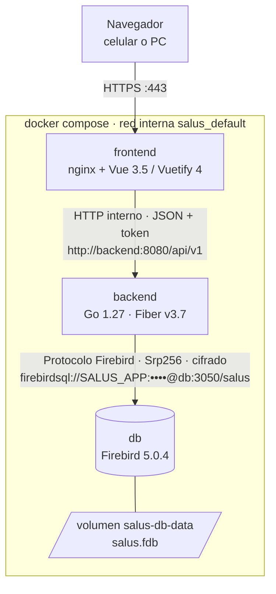

# 08 · Arquitectura

Tres contenedores en la red interna de `docker compose` (proyecto `salus`, red `salus_default`). En producción solo el frontend se publica hacia afuera.

## Componentes y versiones

| Contenedor | Estado | Stack y versión | Qué lleva | Puerto |
|---|---|---|---|---|
| `frontend` | Código base (0.1); contenedor en 0.6 | Vue 3.5 · Vuetify 4.0 · TypeScript 5.9 · Vite 8 · Pinia 3 · Vue Router 5 · build con Node 26 + pnpm 12.18 · servido con nginx | Pantallas, tema, validación de formularios, guardas por rol; reenvía `/api` al backend | 80/443 público |
| `backend` | Listo (0.3) | Go 1.27 · Fiber v3.7 · driver `nakagami/firebirdsql` 0.9 · imagen distroless no root (~24 MB) | config, conexión, migraciones, middleware (seguridad, logs, límites), formato único de respuestas, Scalar | 8080 interno |
| `db` | Listo (0.2) | Firebird 5.0.4 · imagen `firebirdsql/firebird:5.0.4` | Alias `salus`, usuarios SYSDBA y SALUS_APP, UTF8, zona horaria de México | 3050 interno |

## Cadenas de conexión

| Desde → hacia | Cadena |
|---|---|
| Navegador → frontend (producción) | `https://<dominio-salus>/` |
| Navegador → frontend (desarrollo) | `http://localhost:3000` |
| Frontend → backend | `/api/v1/...` (mismo origen; nginx o Vite reenvían a `http://backend:8080`) |
| Backend → Firebird (compose) | `firebirdsql://SALUS_APP:••••@db:3050/salus?charset=UTF8&wire_crypt=true&auth_plugin_name=Srp256` |
| Backend → Firebird (`go run` local) | igual, con host `127.0.0.1` |
| Beekeeper Studio / isql (desarrollo) | host `127.0.0.1` · puerto `3050` · base `salus` · usuario `SALUS_APP` |
| Documentación de la API (desarrollo) | `http://localhost:8080/docs` |

La contraseña nunca va escrita en el código: se arma desde `.env`.

## Seguridad de la base
- La app se conecta con `SALUS_APP` (dueño de la base `salus`). **Nunca con SYSDBA**: la API se niega a arrancar si se configura así.
- Solo se aceptan alias: si `FIREBIRD_DB_ALIAS` parece una ruta, la API no arranca.
- `DatabaseAccess = Restrict /var/lib/firebird/data`: Firebird no abre archivos fuera del volumen de datos.
- Autenticación `Srp256` y cifrado del canal (`WireCrypt = Required`).
- El puerto 3050 solo se publica en `127.0.0.1` y únicamente en desarrollo.

## Protección de la API
- Límite por IP con ventana deslizante: 120 peticiones por minuto en general y 30 escrituras por minuto.
- Rechaza peticiones a `/api` sin `User-Agent` y escrituras que no sean JSON.
- CORS solo con orígenes exactos (sin `*`; https obligatorio en producción). En producción no se usa: el front va por el mismo origen.
- Cabeceras de seguridad (helmet), tope de 1 MB por petición, tiempos de espera y tope de conexiones simultáneas.

## Logs
- Una línea por petición: método, ruta, código, milisegundos, IP y `requestId`. Nunca cuerpos, contraseñas, tokens ni cookies.
- Desarrollo: texto legible. Producción (`APP_ENV=production`): JSON por la salida estándar, para que Docker o un colector los guarde.
- Los errores 500 se registran completos en el log; al cliente solo le llega un mensaje genérico con el `requestId` para rastrearlo.

## Flujo de una petición
1. El navegador pide la app al **frontend** (nginx) y recibe los archivos de Vue.
2. Vue llama a `/api/v1/...`; nginx reenvía esa ruta al **backend** por la red interna.
3. El backend valida el token y el rol, aplica la regla de negocio y consulta **Firebird** con el alias `salus`.
4. Firebird resuelve el alias a `/var/lib/firebird/data/salus.fdb` (en el volumen) y responde.
