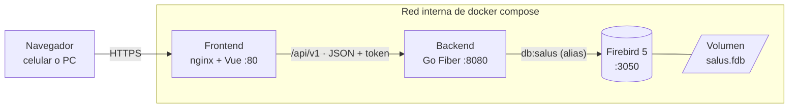

# 08 · Arquitectura

Tres contenedores en la red interna de `docker compose`. Solo el frontend se publica hacia afuera.

| Contenedor | Imagen | Responsabilidad | Puerto hacia afuera |
|---|---|---|---|
| `frontend` | Se construye: `pnpm build` → nginx | Sirve la app Vue y reenvía `/api` al backend (mismo origen, sin CORS en producción) | Sí (80/443) |
| `backend` | Se construye: binario Go | API REST, autenticación, roles y reglas de negocio | No |
| `db` | `firebirdsql/firebird:5.0.4` | Datos; se accede solo por el alias `salus` | No (en desarrollo solo `127.0.0.1:3050`) |

## Flujo de una petición
1. El navegador pide la app al **frontend** (nginx) y recibe los archivos de Vue.
2. Vue llama a `/api/v1/...`; nginx reenvía esa ruta al **backend** por la red interna.
3. El backend valida el token y el rol, aplica la regla de negocio y consulta **Firebird** con `db:salus`.
4. Firebird resuelve el alias a `/var/lib/firebird/data/salus.fdb` (en el volumen) y responde.

En desarrollo, Vite (`pnpm dev`) hace el papel de nginx y reenvía `/api` al backend local.
